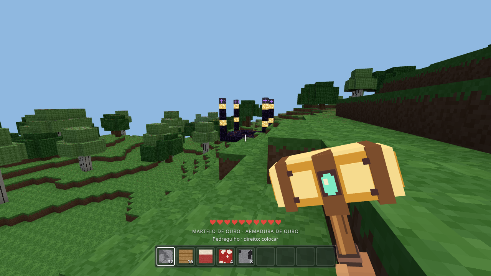
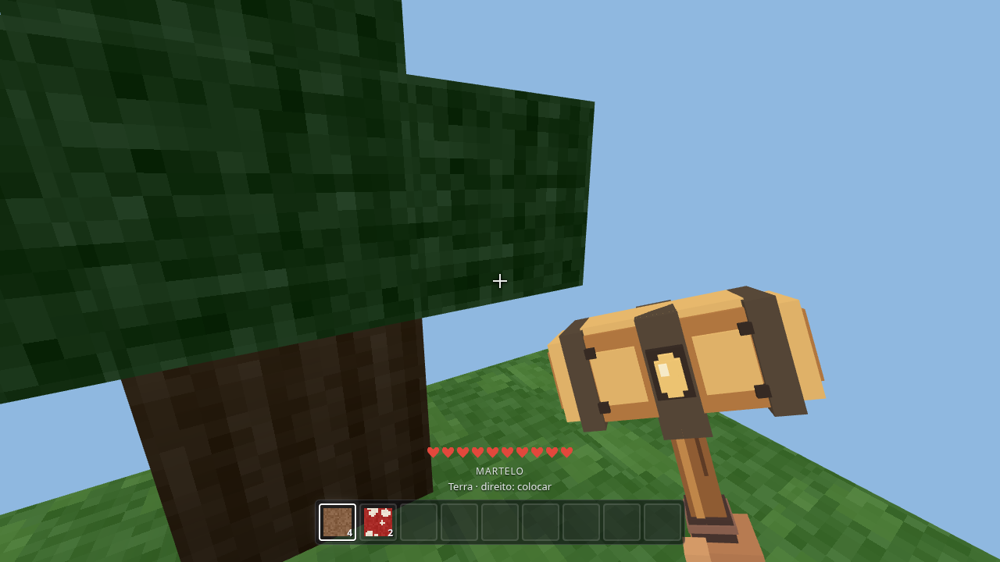
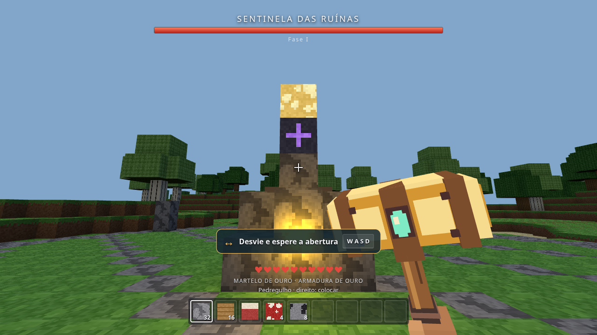
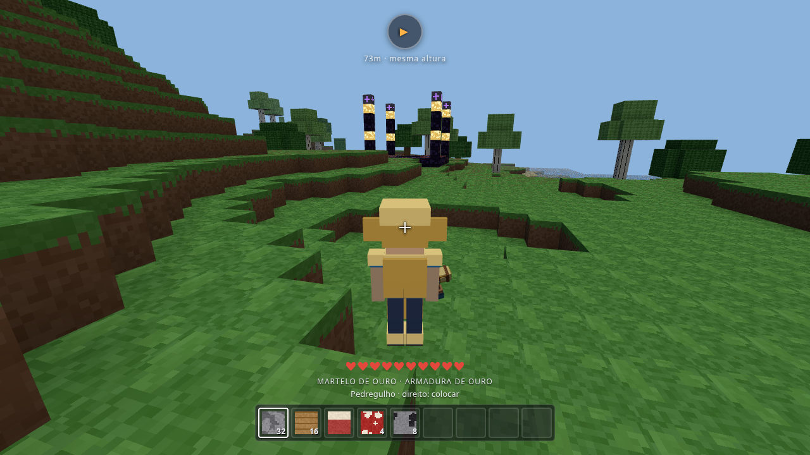
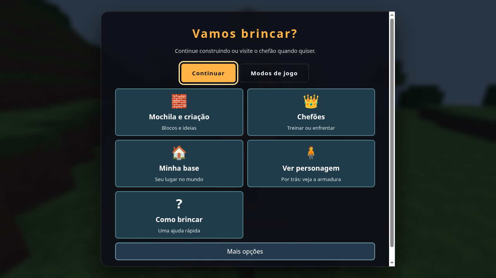
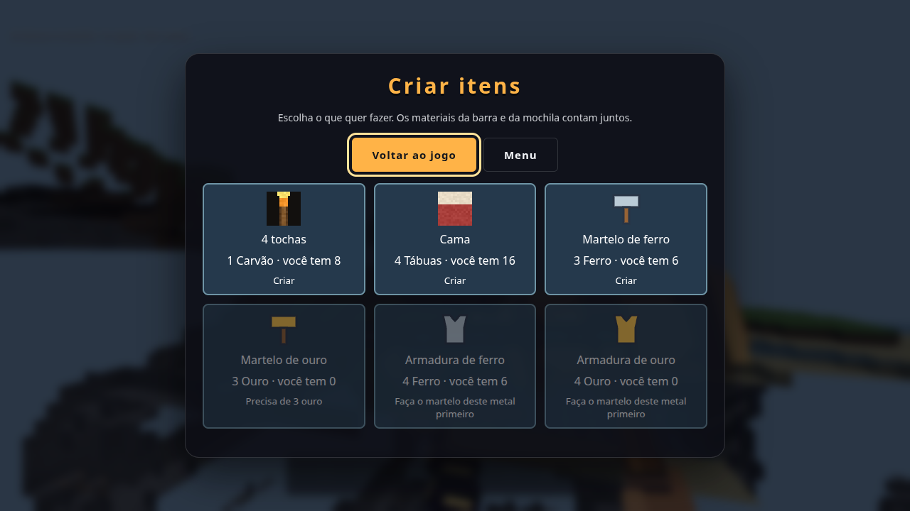

# MineBoss

Jogo de blocos no navegador, em português, para construir, explorar e enfrentar o Sentinela, o Guardião e o Faroleiro quando quiser.

<p align="center">
  <a href="https://gamestudio42.github.io/mineboss/"></a>
  &nbsp;
  <a href="https://github.com/gamestudio42/mineboss/stargazers"></a>
  &nbsp;
  <a href="https://github.com/gamestudio42/mineboss/fork"></a>
  &nbsp;
  <a href="https://github.com/gamestudio42/mineboss/actions/workflows/ci.yml"></a>
</p>

<table>
  <tr>
    <td width="33%" align="center"></td>
    <td width="33%" align="center"></td>
    <td width="33%" align="center"></td>
  </tr>
  <tr>
    <td align="center">Aventura</td>
    <td align="center">OneBlock</td>
    <td align="center">O Sentinela</td>
  </tr>
  <tr>
    <td align="center"></td>
    <td align="center"></td>
    <td align="center"></td>
  </tr>
  <tr>
    <td align="center">O personagem por trás</td>
    <td align="center">Menu <strong>Vamos brincar?</strong></td>
    <td align="center">Criar itens</td>
  </tr>
</table>

Dá para jogar no site sem instalar nada. Quem quiser ajudar pode abrir uma [issue](https://github.com/gamestudio42/mineboss/issues) ou um pull request. O código e os comentários ficam em inglês; os textos da tela, em português.

## Jogar no site e no computador

O jogo publicado está em https://gamestudio42.github.io/mineboss/.

Para abrir uma cópia local:

```sh
pnpm install
pnpm dev
```

Abra http://localhost:5173/ num navegador com WebGL2. Use Node compatível com Vite 8 (20.19+ ou 22.12+). A porta é fixa: se estiver ocupada, o servidor avisa em vez de abrir outro endereço.

O save do site e o de `localhost` são separados. Cada origem do navegador guarda a própria partida.

## Modos

Na primeira visita, sem nenhum mundo salvo, **▶ Jogar** abre direto a Construção livre da Aventura, com o catálogo e a lição de construir. **Outros modos** leva à lista de sempre. Quem já tem um mundo salvo vê a lista de modos.

- **Aventura / Sobrevivência:** explore o terreno, colete recursos, faça ferramentas e construa uma base.
- **Aventura / Construção livre:** catálogo visual com materiais ilimitados e voo. Abra com B. O inventário de Sobrevivência fica guardado ao trocar de estilo.
- **OneBlock:** a nova partida usa o ritmo Curto: a ruína aparece aos 80 blocos, o santuário aos 130 e o farol aos 160. O ritmo Clássico (320, 520 e 640) fica em **Cuidar dos mundos > Nova partida no ritmo clássico**. Planície e Floresta são curtas, os monstros começam em Minérios, e a fase Jardim traz musgo, flores e baús. O Faroleiro fica na ilha ao sul. Saves antigos mantêm o ritmo Clássico. Metas opcionais de ampliar a ilha e iniciar um abrigo dão materiais uma única vez e aparecem no **Álbum**.

O narrador lê em voz alta, em português, cada novo objetivo, as dicas do guia, as etapas da lição de construir e os avisos principais da luta ("Pule a onda!", "Bata agora!"). Não repete a mesma frase em seguida e não fala "Acertou!". Fica em **Som e conforto > Ler as dicas em voz alta**, ligado por padrão, e se cala com **Sem som**. Usa a voz do navegador: se o sistema não tiver voz em português, o jogo continua só com texto.

Durante o jogo livre, a tela mostra só o objetivo e a dica do momento. A linha de teclas some depois da lição de construir (ou depois de um minuto e meio na Sobrevivência e no OneBlock) e volta nas lutas; H abre a ajuda completa. O progresso das fases só aparece no OneBlock.

O menu Esc destaca **Construir**, **Chefões**, **Minha base**, **Álbum** e **Como brincar**, com figuras grandes. Tab e Shift+Tab navegam, Enter ativa e Esc volta. **Marcar minha base** guarda um chão seguro; **Voltar à base** retorna à construção. Em **Mais opções** ficam o estilo da Aventura, a dificuldade, a proteção de borda, o guia e a importação ou exportação do mundo.

A dificuldade Tranquila é o padrão: menos dano dos monstros, mais tempo nos avisos dos chefões e mira mais generosa, que acerta um alvo mesmo com a mira um pouco ao lado. No OneBlock, também há menos inimigos e a lava surpresa fica desligada. O núcleo avisa antes de gerar um monstrinho.

## Controles

- WASD ou setas: andar. Espaço: pular ou nadar para cima. Shift: correr, mergulhar ou descer no voo.
- Botão esquerdo: clique para remover na Construção livre; segure para minerar na Sobrevivência; clique ou segure para atacar. Botão direito: colocar, usar ou enfrentar um chefão.
- 1–9 ou roda do mouse: escolher material. Segure Q por meio segundo para soltar um bloco; um toque rápido só avisa.
- B: catálogo na Construção livre; mochila na Sobrevivência. C: criar tochas, cama, martelos e armaduras, fora das lutas. Cada martelo novo minera mais rápido e bate mais forte que o anterior: madeira, ferro e ouro. H: ajuda.
- V: ver o personagem por trás e voltar à primeira pessoa. A armadura aparece no corpo, com capacete.
- F: ligar ou desligar o voo na Construção livre. Espaço sobe e Shift desce. Movimentos curtos ficam lentos para construir; segurar W por um segundo acelera. Nenhum comando usa Ctrl, porque Ctrl+W fecha a aba no navegador.
- Fechar ou recarregar a aba durante o jogo pede confirmação ao navegador.
- Z: desfazer. Y ou Shift+Z: refazer, na Construção livre e fora das lutas. Até 50 edições por sessão; uma nova edição descarta o refazer.
- Esc: pausar e salvar.

A proteção de borda deixa o personagem entrar em buracos andando. Na Construção livre, procura um chão sólido em qualquer profundidade. Na Sobrevivência, aceita descidas de até quatro blocos, sem dano de queda. O vazio e as colunas com lava continuam bloqueados. Pular permite sair da borda. A proteção pode ser desligada no menu e não impede um empurrão durante o salto.

## Chefões

São três, e todos opcionais: o **Sentinela** na ruína, o **Guardião** no santuário e o **Faroleiro** no farol ao sul.

**Esc > Chefões > Treinar com segurança** pratica onda, círculo e golpe sem perder vida. Com um bloco na barra, o treino oferece um bônus: colocar um bloco entre você e o boneco e ver a onda parar no muro. Qualquer resultado segue para a próxima etapa. **Visitar o Sentinela**, **Visitar o Guardião** e **Visitar o Faroleiro** pedem confirmação antes de transportar. Também dá para caminhar até a estátua, o altar ou a luz do farol. Na Construção livre, voo e invulnerabilidade ficam suspensos durante a batalha e voltam ao vencer, sair ou morrer.

Pule as ondas, saia dos círculos e ataque quando aparecer **BATA AGORA!**. Um bloco sólido na altura dos pés, a até três blocos de você e no caminho da onda, segura a onda; a tela mostra "O muro protege você". Na primeira onda que acertar numa luta, o jogo sugere o muro se houver um bloco na barra. O muro não protege dos círculos nem da investida.

O Faroleiro é o último chefão e o mais resistente dos curtos (240 de vida, contra 200 do Sentinela). Ele alterna o golpe no chão com um feixe de luz que dá uma volta inteira rente ao chão. O feixe pisca por mais de um segundo antes de girar, começa do lado oposto ao jogador e passa uma vez por ele: pule quando aparecer "Pule o feixe!" ou fique atrás de um bloco. Na Tranquila, o aviso e o giro ficam mais lentos, pela mesma regra dos chefões. O golpe nessa hora tem som próprio e segura os inimigos por um instante; a troca de fase e o golpe final seguram um pouco mais. A câmera e o personagem continuam livres. Comida recupera vida com o botão direito. Morrer mantém os itens, escolhe um ponto seguro e concede cinco segundos de proteção. O menu permite sair da batalha.

Cada chefão concede um troféu único e materiais na primeira vitória, além de uma decoração: emblema do Sentinela, lanterna do Guardião ou lanterna do farol. Os troféus também aparecem em Decoração no catálogo. Cada vitória também muda o mundo, e a tela de vitória diz o que procurar: a ruína do Sentinela ganha tochas acesas nos postes, o Guardião ilumina a escada do santuário com pedra luminosa e o Faroleiro deixa o farol mais alto, com tochas nos pilares. O sinal fica salvo junto com a vitória, volta ao recarregar o mundo e nunca troca nem preenche um bloco que o jogador colocou ou quebrou. As batalhas podem ser repetidas. Ataques e restaurações de estruturas preservam os blocos colocados pelo jogador.

## Materiais e saves

O catálogo inclui oito cores e vidro com janelas transparentes. A barra criativa fica separada da mochila de Sobrevivência. O tutorial visual e as ideias de casa, ponte e castelo são opcionais: cada ideia tem três etapas e um botão para colocar os materiais na barra, sem construir sozinha no mundo. A prévia translúcida mostra onde o próximo bloco vai ficar.

**Esc > Álbum** junta, num lugar só, as construções reconhecidas, os troféus dos chefões e, no OneBlock, as metas da ilha. O álbum só registra o que você já fez e não cria tarefas novas. Ele reconhece três ideias, construídas com os seus blocos e do seu jeito:

- Casa: paredes em volta, uma porta de 1 bloco e um telhado por cima.
- Torre: 6 blocos, um em cima do outro.
- Curral: uma cerca baixa e fechada, com um portão de 1 bloco. Ele entra no álbum se continuar curral por alguns segundos, para que a primeira fileira de paredes de uma casa não conte como curral.

O primeiro curral traz um bichinho, um porquinho que mora lá dentro. Clique nele com o botão direito para ele seguir você; clique de novo para ele esperar no curral. Em casa, uma cerca de 1 bloco basta para segurá-lo; seguindo você, ele sobe degraus e cercas. Ele não leva dano, não atrapalha o martelo e espera em casa durante as lutas. Se ficar muito longe, alcança você quando você pisa no chão. O álbum e o bichinho são salvos com o mundo.

Os materiais que não cabem nos nove espaços vão para a mochila. B troca o material do espaço selecionado por um da mochila. Tudo isso é salvo, inclusive o inventário de Sobrevivência durante a Construção livre.

O aviso no canto indica se o navegador gravou a partida. No menu, **Exportar mundo** baixa um JSON e **Importar mundo** valida o arquivo antes de substituir só o modo correspondente. Arquivos acima de 20 MB ou 300 mil edições são recusados. Saves locais v1 a v4 continuam legíveis. O formato atual é v5.

Uma cópia anterior válida por modo pode ser recuperada pelo menu. O checkpoint atualiza cerca de uma vez por minuto, ou ao trocar de mundo. Um save principal corrompido usa essa cópia. Recarregar durante um combate ou treino volta à posição anterior ao encontro, sem chefão ativo, e preserva base, inventários, estilo, voo, guia e prêmios já confirmados.

## Conforto

**Som e conforto**, na abertura, e **Mais opções**, na pausa, oferecem:

- Câmera tranquila: tira o balanço ao andar, o tremor dos impactos e a ampliação ao correr.
- Efeitos suaves: reduz partículas, flashes e a pulsação da barra.
- Qualidade Leve, Equilibrada (padrão) ou Caprichada: ajusta a distância do terreno, a resolução, as partículas e as luzes de tocha. A preferência fica neste navegador.
- Ler as dicas em voz alta: liga ou desliga o narrador.
- Música: uma melodia calma, só com notas que combinam, enquanto você joga, e um tema mais rápido nas lutas. Os menus ficam em silêncio. Começa ligada e se cala com **Sem som**.

## Verificação

```sh
pnpm test
pnpm build
```

Os testes cobrem inventário, receitas, desfazer, vidro, saves v1–v5, recuperação, base obstruída, controles, treino, os três chefões, os sinais de vitória, morte, saída, recarga, OneBlock, música, álbum e bichinho. A evidência e os limites estão em [TESTING.md](TESTING.md). A avaliação de diversão com a criança continua sendo uma sessão acompanhada.

TypeScript, three.js e Vite. Texturas em canvas, áudio sintetizado e malhas voxel em workers. Esta versão é para um jogador.

## Fork e remix

O código é MIT. Clone, mude as regras e publique o seu fork no GitHub Pages.

```sh
git clone https://github.com/gamestudio42/mineboss.git
cd mineboss
pnpm install
pnpm dev
```

Issues de entrada e conversa: [good first issue](https://github.com/gamestudio42/mineboss/labels/good%20first%20issue)
e [discussions](https://github.com/gamestudio42/mineboss/discussions). Guia em [CONTRIBUTING.md](CONTRIBUTING.md).

## Licença

MIT. Game Studio 42.
